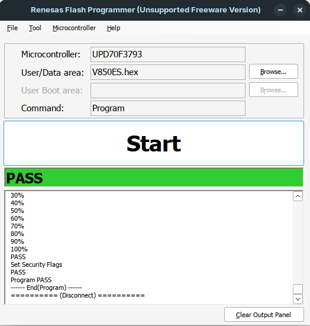
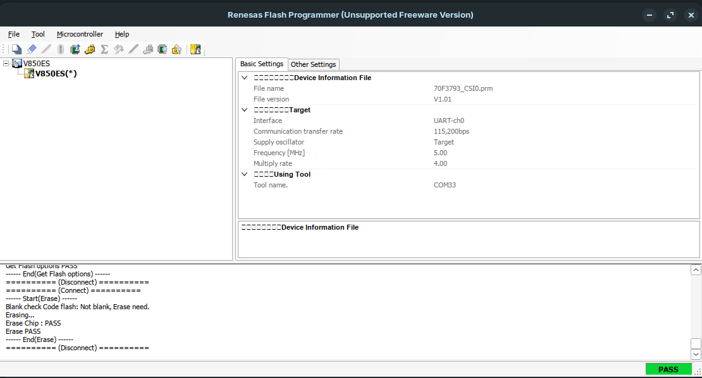

# Bare Metal V850ES/JG3-L Project

[](https://github.com/Chalandi/Baremetal_v850es_nosdk/actions)

This repository contains a bare-metal firmware project for the Renesas V850ES/JG3-L family, targeting the μPD70F3793 microcontroller. The project is designed to provide a clean and educational starting point for embedded software development without relying on Renesas’ proprietary SDK.

The codebase focuses on direct register access, custom startup initialization, linker configuration, and a GNU Make-based build flow. It is intended for learning, experimentation, and firmware development in a minimal embedded environment.

## Overview

This project demonstrates how to build a small firmware image from scratch using:

- C11 for application logic
- Assembly for startup and interrupt handling
- A custom linker script for memory layout
- A custom Makefile for compilation, linking, and output generation
- Generic GNU toolchain support for V850 targets

The repository is organized to separate low-level infrastructure from application code, making it easier to understand how a bare-metal firmware project is structured.

## Application Behavior

The sample application in `Code/Appli/main.c` performs the following:

- Initializes the UART peripheral at 115200 baud
- Prints the message: `Hello from V850ES!`
- Configures a hardware timer interrupt
- Toggles an LED through a periodic interrupt routine
- Enters a permanent foreground loop while waiting for timer events

This provides a simple yet complete demonstration of:

- direct peripheral register access
- timer-driven interrupt handling
- GPIO control
- serial output for debugging

## Repository Structure

```text
.
├── Build/                  # Build scripts and Makefile
│   ├── Build.sh
│   ├── Build.ps1
│   ├── Clean.sh
│   ├── Clean.ps1
│   ├── Rebuild.sh
│   ├── Rebuild.ps1
│   └── Makefile
├── Code/                   # Firmware source files
│   ├── Appli/
│   │   └── main.c
│   ├── Mcal/
│   │   ├── pll.c
│   │   ├── uart.c
│   │   └── wdt.c
│   ├── Startup/
│   │   ├── Startup.c
│   │   ├── boot.s
│   │   └── intvect.s
│   ├── StdLib/
│   │   ├── printf/
│   │   └── StdLib.c
│   └── V850ES.ld
├── Doc/                    # Vendor documentation
│   ├── R01UH0121ED0100.pdf
│   ├── U15943EJ4V0UM00.pdf
│   └── U18953EJ5V0UD00.pdf
├── Tools/                  # Utility and flashing tools
│   ├── scripts/
│   └── Renesas Flash Programmer V2.05/
├── .gitignore
├── LICENSE
├── README.md
└── Output/                 # Generated firmware artifacts
```

## Building the Project

From the repository root, run:

```
cd ./Build
./Rebuild.sh
```

You can also use:

```
./Build/Build.sh
```

The build process compiles the firmware and generates output files in the `Output` directory, including:

- ELF executable
- HEX file
- BIN file
- MAP file
- Disassembly and symbol-related reports

## Flashing the Binary

After a successful build, use Renesas Flash Programmer tool from the `Tools` folder to flash the generated firmware image to the target board.






## Tools

The following tools are needed to build and flash the application :

| Tool                        | Link                                                         |
| --------------------------- | ------------------------------------------------------------ |
| V850 GCC compiler (Linux)   | https://github.com/ckormanyos/gcc-v850-unknown-elf/releases/download/v16.2.0/gcc-16.2.0-v850-unknown-elf.tar.gz |
| V850 GCC compiler (Windows) | https://github.com/ckormanyos/gcc-v850-unknown-elf/releases/download/v16.2.0/gcc-16.2.0-v850-unknown-elf_x86_64-w64-mingw32.zip |
| Renesas Flash Programmer    | https://github.com/Chalandi/Baremetal_v850es_nosdk/blob/master/Tools/Renesas%20Flash%20Programmer%20V2.05/Renesas%20Flash%20Programmer%20V2.05.7z |

## Continuous Integration

The repository includes GitHub Actions-based continuous integration to validate the project build on a clean environment. CI runs automatically for pushes and pull requests using `ubuntu-latest`.

## License

This project is licensed under the MIT License. See the `LICENSE` file for more information.
